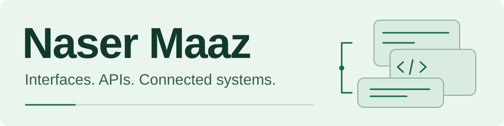

<picture>
  <source media="(prefers-color-scheme: dark)" srcset="./assets/header-dark.svg">
  <source media="(prefers-color-scheme: light)" srcset="./assets/header-light.svg">
  
</picture>

# Full-Stack Developer

**React · TypeScript · Node.js**

I'm Mohammed Naser Maaz, an Information Engineering student building business websites, admin dashboards, and AI-assisted tools. I work across responsive interfaces, REST APIs, databases, and service integration.

**Open to full-stack and React development opportunities.**

**[Explore my portfolio](https://portfolio.nasermaaz20.workers.dev/)** &nbsp; · &nbsp; **[Connect on LinkedIn](https://www.linkedin.com/in/naser-maaz)**

## Selected work

### DESIGN-MAN

**Independent website development · Client portfolio**

I independently built the complete website for graphic designer **Yaman Balkesh**, including the responsive interface and motion effects. The featured graphic-design work belongs to Yaman.

`React` `Tailwind CSS` `GSAP` `Framer Motion`

**[Visit website](https://design-man.naser-nsrfnz2000.workers.dev/)** · [View code](https://github.com/nasermaaz-20/design-man-portfolio) · [Build checks](https://github.com/nasermaaz-20/design-man-portfolio/actions/workflows/ci.yml)

### TechnoSoft

**Full-stack development · Business website**

An Arabic RTL business website with a product catalog, service listings, and an admin dashboard for managing content.

`React` `Tailwind CSS` `Express` `MongoDB`

**[Visit website](https://technosoft-store.com/)** · [View code](https://github.com/nasermaaz-20/technosoft-store)

### NexHire

**Team project · Job recommendations**

My teammate and I jointly developed the frontend, backend, recommendation service, and database. The system combines content-based and collaborative recommendations.

`React` `Express` `Python` `FastAPI` `PostgreSQL`

[Explore the code & setup](https://github.com/nasermaaz-20/nexhire-job-recommendation)

### LaptopZone

**University project · E-commerce**

A store with a cart, wishlist, authentication, and admin tools. Checkout is a simulated frontend flow.

`React` `TypeScript` `PHP` `MySQL`

[Explore the code & screenshots](https://github.com/nasermaaz-20/LaptopZone)

## Toolkit

- **Frontend:** React, TypeScript, JavaScript, Tailwind CSS, responsive & RTL interfaces
- **Backend & data:** Node.js, Express, PHP, REST APIs, PostgreSQL, MySQL, MongoDB
- **AI & integration:** Python, FastAPI, n8n, recommendation systems, AI/LLM integration
- **Tools & motion:** Git, GitHub, Vite, GSAP, Framer Motion

My experience includes freelance and independent development projects, with a background in IT and hardware troubleshooting.

---

Interested in working together? **[Let's connect on LinkedIn](https://www.linkedin.com/in/naser-maaz)**
